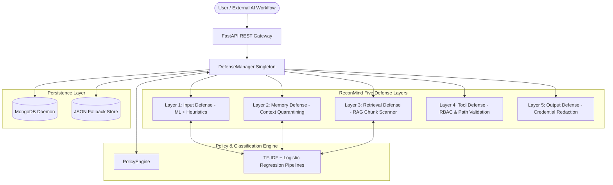

# ReconMind System Architecture

## Architectural Overview

ReconMind decouples defensive inspection into five distinct layers coordinated by a centralized PolicyEngine and DefenseManager:

## Defensive Decision Flow

Each defense layer evaluates its respective payload and emits a verdict:
- **`PASS`**: Payload satisfies all heuristic and machine learning safety bounds.
- **`SANITIZE`**: Mild anomalies or sensitive tokens detected; dangerous parts are redacted or quarantined.
- **`BLOCK`**: High-confidence adversarial injection, privilege violation, or path traversal detected.
